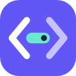

# Codex Dock · Lovest Code

在 Windows 上管理 Codex 配置、账号接入与后台网关，在手机上继续聊天、查看任务、处理审批和使用项目工作台。

项目包含 Windows 应用 **Codex Dock**、由 Windows 托管的 **Web / 手机网关**，以及独立安卓客户端 **Lovest Code**。手机端连接自己的电脑和原生执行环境，聊天能力由所选 Codex Desktop、CLI 或已登记的 WSL / SSH 提供。

[Windows 下载](https://github.com/Lovest20018/Codex-Dock/releases/latest) · [Android 下载](https://github.com/Lovest20018/Codex-Dock/releases/tag/android-v0.2.4) · [全部版本](https://github.com/Lovest20018/Codex-Dock/releases) · [构建流程](https://github.com/Lovest20018/Codex-Dock/actions/workflows/release.yml) · [反馈问题](https://github.com/Lovest20018/Codex-Dock/issues)

## 当前状态

截至 2026-11-11，本仓库的版本为：

| 应用 | 版本与下载 | 本版更新 |
| --- | --- | --- |
| Windows · Codex Dock | **[0.17.1](https://github.com/Lovest20018/Codex-Dock/releases/tag/v0.17.1)** | 明确模板写入与保留行为，提供内置配方预览和旧上下文停用方案，修复来源与表格式保护。 |
| Android · Lovest Code | **[0.2.4](https://github.com/Lovest20018/Codex-Dock/releases/tag/android-v0.2.4)** / versionCode 7 | 应用内检查更新、校验下载并打开系统安装器；保留通知、原图下载、草稿和三页导航。 |

**Windows 与 Android 独立更新、独立发布。** Windows Release 只放 EXE、便携包和对应源码；Android Release 只放 APK 和对应源码，各自附带校验清单与验证记录。Windows 使用 `vX.Y.Z` 标签，Android 使用 `android-vX.Y.Z` 标签。历史合并版保留，新版本按平台发布，维护方式见 [发布说明](docs/github-releases.md)。

完整使用本轮功能，请配套使用 Windows **0.17.1** 与 Android **0.2.4**。Web 页面、手机后台与模型兼容性随 Windows 更新；应用内更新、独立通知、原生冷启动和图片下载支持随 APK 更新。

Web / 手机工作台复用固定的 Codex Mobile Bridge 2.1.7 快照，选择性移植上游 2.2.0 修复，并通过显式覆盖和自有适配提供 Codex 范围的功能。上游来源、许可与维护方式见 [UPSTREAM](src/CodexMobile/UPSTREAM.md) 和 [本轮移植记录](docs/mobile-upstream-backport-2026-11-09.md)。

0.16.0 完成三批配置优化：配置目录更新、组合校验、已配置实例、配置来源、独立 profile，以及压缩与连接耗时诊断。使用入口和验证边界见 [实施记录](docs/configuration-implementation-2026-11-02.md)。

0.17.0 补入 Superba alpha.15 的第一批配置更新：目录增至 1064 条结构定义、调整社区模板默认选择、增加逐站 HTTP 确认，并在保存成功页提供 **重启 Codex 并应用**。使用方式与验收状态见 [合并记录](docs/superba-reuse-implementation-2026-11-11.md)。

0.17.1 修正模板应用逻辑：逐项显示将写入或保留的值；本地已编辑方案可直接预览本版内置配方；新增明确写入三项 `false` 的旧上下文停用方案。升级不自动应用模板，详见 [模板修正与验收](docs/template-application-fix-2026-11-11.md)。

## 可以做什么

| 使用场景 | 功能 |
| --- | --- |
| 配置 Codex | 修改服务地址、PAT / Responses API Key、默认模型及常用设置；搜索配置说明；查看遮盖凭据的更改预览。 |
| 保留官方账号并连接独立模型入口 | 使用原生 `codex.exe` 登录 ChatGPT，通过可选本机模型网关将模型请求转到所选 PAT / API 服务。 |
| 从手机继续工作 | 查看与继续聊天、处理权限及输入请求、使用消息队列和附件；按执行端能力使用文件预览、Git 和终端。 |
| 管理接入 | 在电脑的本机管理页登记官方账号、API 与 CLI / WSL 接入；手机使用已登记的执行环境。 |
| 日常维护 | 配置模板、保存前加密备份、冲突提示、恢复、托盘、开机启动和 Windows 软件更新。 |

模型目录可按需获取，保存本地配置不要求服务在线。保存成功只确认本机写入；模型能力、订阅资格和远端连通性仍取决于实际服务。

## Windows 安装与更新

Windows 支持 **Windows 10 1809 及以上 x64**。完整安装包包含 .NET 与手机后台运行时；请另外安装所需的 Codex 客户端。

| 文件 | 用法 |
| --- | --- |
| `CodexDock-<版本>-Setup-win-x64.exe` | 运行安装向导。 |
| `CodexDock-<版本>-win-x64.zip` | 完整解压，运行 `CodexDock.exe`；保留旁边的整个 `mobile` 目录。 |
| `SHA256SUMS-<版本>.txt` | 核对 Windows 交付文件的 SHA-256。 |

从 [Windows 发布页](https://github.com/Lovest20018/Codex-Dock/releases/latest) 下载安装器或便携包。Windows 0.16.1 起，可在应用设置或托盘选择 **停止网关并退出**；软件内安装更新会停止当前配置的手机与模型网关，并等待进程退出。旧版升级前先停止两个网关并退出。更新后重新启动手机服务并检测 HTTPS 入口。

## Android 安装与更新

从 [Android 0.2.4 发布页](https://github.com/Lovest20018/Codex-Dock/releases/tag/android-v0.2.4) 下载 `LovestCode-Android-0.2.4.apk`，适用于 Android 8 / API 26 及以上。核对 `SHA256SUMS-Android-0.2.4.txt` 后安装，需要允许浏览器或文件管理器安装此 APK。

Lovest Code 沿用本项目安卓包名、签名与 Logo，0.2.4 可直接覆盖安装 0.2.3，保留连接和登录。以后在“我的 → 版本与更新”检查新版，确认后由应用下载、校验并打开系统安装器；首次按提示允许 Lovest Code 安装应用。0.2.3 及更早版本需先手动覆盖安装 0.2.4 一次，不要卸载。它与旧上游 App 是不同应用，首次迁移需重新添加电脑并登录。电脑上的聊天记录不受影响。

尚未公开的构建可从 Actions 成功运行的 Artifacts 下载所选平台的 `windows-release` 或 `android-release`。

## 配置电脑端

1. 打开 **连接与账号**，确认正在编辑的 Codex 配置目录。
2. 选择服务类型，填写地址、PAT / API Key 与模型 ID；普通 Responses 服务在更多连接选项中选择对应类型。
3. 点击 **查看并确认修改** 或按 `Ctrl+S`，核对目标文件与修改前后值，再点击 **确认写入**。修改普通设置时，无须重新填写凭据。
4. 完全退出并重新打开 Codex，再新建聊天核对。也可在保存成功页选择 **重启 Codex 并应用**，确认程序和配置目录后继续。

选择 **官方账号 + 独立模型入口** 时，先检测已有文件凭据或使用 **ChatGPT 登录**，再保存模型入口。登录结果先暂存，保存后才写入当前目录并启动模型网关。该模式保留原生官方身份，为模型请求替换独立凭据；服务失败时不会自动使用官方额度。

此模式要求文件凭据，不会自动转换 `keyring` / `auto`。网关支持 HTTP / SSE、压缩请求和 WebSocket 转发，是否可用取决于上游服务；完整能力和真实线路验证边界见 [0.12.0 审查](docs/review-0.12.0.md)。

可在 **手机连接 → 后台服务 → 重启**、**连接与账号 → 本地模型网关 → 重启**，或托盘菜单中分别重启两个网关。独立重启使用已保存设置，保留草稿和手机登录；连接会短暂中断。

新增配置功能位于 **全部配置**：选择 **已配置** 可直接编辑实际 MCP / 供应商名称；**更多选项** 可添加结构化实例。展开 **来源与 profile**，选择本机执行端和项目目录后读取文件值、执行端值及配置层；此快照不包含现有聊天参数和未保存草稿。**管理 Profile 文件** 独立保存 `<名称>.config.toml`，通过 `codex --profile <名称>` 选择。当前核查内核的 app-server 不支持读取指定 profile 的来源，界面会明确显示未确认。

**配置模板** 提供日常 high / 复杂任务 xhigh，只修改所选推理强度。混合连接的模型网关状态区分别显示压缩请求、返回条目和确认完成次数，并提供队列与传输耗时；指标只覆盖经该网关的当前进程流量。

在 **模板与备份 → 配置模板** 选择推荐方案，勾选本次修改后直接进入同一个确认页，无需跳到全部配置再次保存。**编辑方案 / 保存方案** 只修改本机方案库。确认页同时列出此前未保存的修改；返回调整保留原有草稿，确认成功后显示实际写入结果与备份入口。**跟随 Codex 配置** 表示移除该项本地覆盖，执行时仍可能继承其他配置层，并不等于套用 Krill 推荐值。

## 连接手机

需要一个已有的、证书受手机信任的 **HTTPS 根域名**，以及从该入口到 Windows 电脑的网络通路。

1. 在 Windows 的 **手机连接** 填写 HTTPS 域名、独立访问账号和密码，点击 **保存并启动**。
2. 将整个 HTTPS 根站点反向代理到电脑可达的 HTTP 端口，默认 `13090`。保留外部 `Host`（含非默认端口）、`Origin`、Cookie 和 WebSocket 升级头。
3. 点击 **检测 HTTPS 入口**；通过后，在 Lovest Code 中扫码或填写域名，再登录。
4. 在电脑点击 **管理 Codex 接入**，登记并启用需要的执行环境，然后从手机继续聊天。

无需填写代理来源 IP。程序支持本机代理、其他设备反代和路由端口映射；手机 HTTP 端口监听 IPv4 接口，私有管理端口只绑定本机。不要将管理端口转发到公网。

`127.0.0.1` 始终指向使用该地址的设备自身：群晖等外部代理应填写 Windows 电脑可达的 IP。Dock 不自动配置域名、证书、穿透、路由或防火墙。详细示例、超时与长连接要求见 [手机连接说明](docs/mobile-connection.md)。

Lovest Code 切换聊天、电脑和我的页面时保留当前 WebView 与草稿，重新打开优先恢复上次聊天。聊天详情收起主导航，模型及高级选项继续可用；0.2.2 移除文字输入区的折叠入口，发送后仍可继续输入。见 [安卓说明](docs/android-dock-shell-plan.md)。

任务运行中，在 **选项 → 发送方式** 选择 **补充当前任务**，可把文字追加到当前任务；**完成后发送** 会排队等待。默认 **发送新消息** 用于开启下一轮。补充时沿用当前工作模式，任务已结束会提示并保留草稿；CLI 接入的补充暂不支持附件。见 [专项验证](docs/review-steering-2026-10-31.md)。

## 数据、保存与后台进程

- 默认读取 `%USERPROFILE%\.codex`；设置 `CODEX_HOME` 时优先使用该目录，也可在应用中选择配置位置。
- Codex 配置页共用一份草稿。保存前检测外部修改并创建加密备份，失败时保留草稿；模板只保存普通设置。
- 连接备注、备份和 Dock 私有设置使用当前 Windows 用户加密。Codex 认证文件按客户端格式保存在本机。
- 手机设置和设备记录按配置目录隔离，位于 `%LOCALAPPDATA%\CodexConfig\mobile\<目录标识>`。密码、域名或账号变更后需重新登录。
- 关闭 Windows 窗口会收起到托盘。退出编辑器后，已启动的网关继续运行；可在各自页面或托盘显式停止。
- 开机启动只启动 Dock，不自动打开手机端口。已保存的混合连接按原有策略恢复模型网关。

活动 profile、项目配置和会话参数可能覆盖文件中的默认值。配置概览展示本地文件状态，不能代表每个运行会话的最终设置。

## 验证与已知边界

仓库包含 .NET 核心与隔离 WPF 检查、手机网关 HTTP / Python 回归、共享 Web 的 Node / 浏览器回归，以及在 Android 14 隔离模拟器上安装实际 APK 的检查。

安卓发送回归使用生产页面和真实触摸，验证连续发送、键盘变化、长回复、输入区保持展开和覆盖升级。补充任务专项另外经过生产 HTTP 与 IPC 链路，由隔离原生 owner 夹具接收；验证三次补充仍归属同一任务、重复提交保护和结束后保留草稿。测试资产仅打入独立测试 APK，不进入正式应用。

模拟器与自动化结果不能覆盖所有厂商键盘、相机扫码、系统缩放、省电策略、公网链路或真实 Codex / WSL / SSH 任务。功能随执行端能力显示，阅读历史不会自动启动或接管原会话；结果未知的写入不会自动重放。具体证据见 [Windows 0.17.1 审查](docs/review-0.17.1.md) 和 [Android 0.2.4 审查](docs/review-android-0.2.4.md)。

## 开发与文档

Windows 使用 C# / .NET 8 / WPF；手机服务使用 Python 3.12；安卓壳使用 Java 17 与 Android SDK 35。源码构建不包含私人签名密钥，详见 [开发与构建](docs/development.md) 和 [安卓构建说明](docs/android-dock-shell-plan.md)。

| 目录 | 内容 |
| --- | --- |
| `src/CodexConfig.App`、`src/CodexConfig.Core` | Windows 界面、配置事务、账号登录及模型 / 手机网关管理。 |
| `src/CodexMobile` | 固定上游、手机服务适配、本机管理页和 Dock 自有 Web 界面。 |
| `src/CodexAndroid` | Lovest Code 自有原生壳、资源和页面适配。 |
| `tests`、`scripts` | 隔离回归、构建、完整性检查与发布包验证。 |

[Windows 0.17.1](docs/release-0.17.1.md) · [Android 0.2.4](docs/release-android-0.2.4.md) · [手机功能对照](docs/mobile-upstream-comparison.md) · [GitHub 发布约定](docs/github-releases.md)

[MIT 许可证](LICENSE) · [第三方许可](THIRD-PARTY-NOTICES.md)
