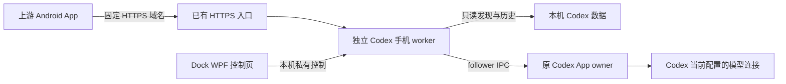

# Codex 手机网关精简复用评估

2026-10-31 初始评估。核对上游提交 `0721aa7dafa6177751ba7e568e0ad0efee05655b`（包版本 2.1.7）与当时的 Dock `500bf4e`。以下保留最初的裁剪建议与评估证据；后续已按此边界在 0.13.0 实现，当前接入和验证结果以 [手机连接说明](mobile-connection.md) 和 [0.13.0 审查](review-0.13.0.md) 为准。

## 结论与推荐结构

可以复用，并且可以保留上游 Android App 的直接 HTTPS 连接和登录协议。推荐从上游提取 **Codex 本机会话服务、认证配对和必要手机网页**，作为 Dock 管理的独立后台 worker。保留 Python 核心，冻结成 Windows 可执行文件；Dock 继续使用 WPF，提供域名、启停、入口检测、二维码和设备撤销。这样能沿用已经存在的 Codex owner 与登录处理，无须打包上游 Electron 桌面端。

当前 Dock 的 `ModelBridge` 只转发模型推理；上游手机网关控制的是原 Codex 会话。两者端口、凭据、生命周期和权限不同。手机登录不等于 ChatGPT 登录，也不应把 PAT / API Key 当作手机访问口令。



“直连 HTTPS 域名”在本方案中指手机始终访问用户自己的固定根域名；采用上游的 `external` 思路，由已有 HTTPS 反向代理转到电脑 worker。程序不管理穿透、服务器或证书。域名必须已经能到达这台电脑；仅填写一个域名不会建立网络通道。首版不加入路径前缀部署。

上游的 [固定入口实现](https://github.com/try2love/codex-mobile-bridge/blob/0721aa7dafa6177751ba7e568e0ad0efee05655b/bridge/features/network/access.py) 已有 HTTPS 根地址校验和实例核对，可按这一条路径裁剪。

## 保留与删除

| 部分 | 建议 | 原因与边界 |
| --- | --- | --- |
| 本机 Codex App 聊天列表、历史、实时状态 | 保留 | 手机使用的核心；发现和读取不启动任务 |
| 发送、补充、停止、原生审批 | 保留 | 使用原桌面 owner；保持原会话 provider、cwd 与权限 |
| 操作 UUID、提交回执、未知结果保护 | 保留 | 断线不能自动重复提交模型任务或审批 |
| 密码登录、一次性配对、CSRF、设备撤销 | 保留 | 支持手动地址登录和 Android 扫码；不能只留下一个鉴权接口 |
| Codex 聊天网页、Android 宿主兼容 | 保留并裁剪 | Android 的主要聊天界面由网关网页提供 |
| HTTPS 固定根域名与入口检测 | 保留 | 仅一个显式域名，生成二维码前验证当前实例 |
| Claude、DeepSeek、其他客户端 | 删除 | 同时删除路由、适配器、网页入口及静态资源 |
| SSH、远端主机、WSL、独立 CLI 恢复 | 首版删除 | 首版只继续 Windows 本机 Codex App 会话，避免扩成执行器管理工具 |
| Quick Tunnel、Cloudflare、Tailscale、NAS 配置、共享 relay | 删除 | 使用现有 HTTPS 入口 |
| 账号池、切换账号、额度、供应商编辑 | 删除 | 手机沿用电脑 Codex 当前配置；已有 Dock 连接管理负责配置 |
| 独立终端、Git 操作、文件工作台、侧边聊天、Goal、新建项目 | 首版删除 | 不属于继续已有聊天的最小闭环 |
| 附件上传、全目录浏览、PDF/HTML/Mermaid 工作台 | 首版删除 | 文本聊天优先；删除接口与依赖，不能只隐藏按钮 |
| Webhook、Bark、ntfy、PushPlus、FCM、后台通知、APK 代下载 | 首版删除 | 不影响基础登录和聊天；网页入口一并移除 |
| 上游 Electron、iOS 源码、自动更新器、多平台打包 | 不引入 | 手机继续使用上游 Android APK，Windows 管理复用 Dock |

“仅 Codex”是客户端范围。用户当前在 Codex 内使用官方登录、PAT、API 或 Dock 混合模型连接，仍由原客户端决定，手机网关不另建模型供应商体系。

## Android 登录必须保留的契约

根据 [GatewayURL](https://github.com/try2love/codex-mobile-bridge/blob/0721aa7dafa6177751ba7e568e0ad0efee05655b/mobile/android/src/io/github/try2love/codexbridge/GatewayURL.java)、[GatewayProbe](https://github.com/try2love/codex-mobile-bridge/blob/0721aa7dafa6177751ba7e568e0ad0efee05655b/mobile/android/src/io/github/try2love/codexbridge/GatewayProbe.java)、[DeviceBinding](https://github.com/try2love/codex-mobile-bridge/blob/0721aa7dafa6177751ba7e568e0ad0efee05655b/mobile/android/src/io/github/try2love/codexbridge/DeviceBinding.java) 与 [HTTP 处理](https://github.com/try2love/codex-mobile-bridge/blob/0721aa7dafa6177751ba7e568e0ad0efee05655b/bridge/api/httpd.py) 的实际调用，原 APK 没有把普通 HTTPS 网关锁定到作者域名。兼容需要以下整体契约：

1. 地址为 `https://域名[:端口]/`；二维码为同源 `/#pair=<43字符base64url令牌>`。网页捕获片段后立即清除，再提交 `POST /api/pair`。片段不作为请求 URL 发送。
2. `GET /api/auth` 至少满足原生探测所需的 `authenticated`、`passwordless` 布尔字段与非空 `instanceId` 字符串。登录后继续提供 `csrf`、`cookieName`、`trustedDevice`、电脑信息与 `enabledClients: ["codex"]`；保留网页所用身份命名空间字段。`passwordless: false`。
3. 保留 `POST /api/login`、`POST /api/pair` 和 `POST /api/logout` 的语义。Cookie 使用 `codex_mobile_session_<24位小写hex>`，保持 `Path=/; Secure; HttpOnly; SameSite=Strict`。服务端仍决定会话有效性。
4. Android 通过 `BridgeMobile/…-Android` 用户代理选择已认证手机的长期会话策略，并依赖服务端持久化与撤销。用户代理本身不构成认证；Cookie 恢复前，原生代码会请求同一网关的 `/api/auth` 验证。
5. 本机管理通道签发与撤销配对码，公开 HTTP 不开放签发。一次性码按精确 Origin 绑定、5 分钟失效、原子消费、刷新旧码失效，并保持尝试限速。见 [pairing.py](https://github.com/try2love/codex-mobile-bridge/blob/0721aa7dafa6177751ba7e568e0ad0efee05655b/bridge/features/auth/pairing.py)。
6. Host、Origin、写操作 CSRF 校验和 TLS 证书验证保持。实例检测不带凭据、不跟随重定向；持有旧设备凭据也不能凭 `instanceId` 迁移到其他域名。
7. 网页保留原 APK 注入所需的 DOM 与 `bridge-authenticated`、`bridge-logged-out`、`bridge-auth-lost` 事件。它们让原生层落盘 Cookie、清除设备绑定或尝试恢复；不能只返回正确 JSON 却删掉网页的登录衔接。

原 APK 自带“账号与接入”“通知收件箱”等菜单。网关裁剪无法删除已安装 APK 的原生菜单；这些附加入口可以明确显示不支持，基础连接与聊天仍可兼容。若要求手机原生界面也只剩最少入口，需另行维护 Android 分支；不能用新签名覆盖作者原 APK。此项不纳入首版。

## 需要实际拆开的耦合

上游 `bridge/app/service.py` 同时导入终端、SSH、CLI、账号池、上传、项目与 Goal；`bridge/api/httpd.py` 也直接导入多客户端管理与更新模块。网页 `web/shell/app.js` 绑定大量可选面板。仅删除目录或设置 `enabledClients` 不会形成可发布的精简版。

建议沿以下边界提取：

- `bridge/features/auth/auth.py`、`pairing.py` 和必要私有 lifecycle 控制；把认证使用的草稿身份辅助函数从账号管理依赖中单独保留。
- `bridge/clients/codex/ipc.py`、Windows 命名管道传输、`features/sessions/store.py` 和状态规范化，以及 `service.py` 中仅限本机 Desktop 的 owner/订阅/发送/审批/回执处理。
- 重组专用 HTTP 路由与静态资源白名单，保留登录和所选会话操作；移除任意 RPC、其他客户端、终端与工作区接口。
- 提取 Codex 网页，删除失效面板绑定和非 Codex 资源，保留原生 Android 登录事件与返回导航。
- WPF 新增独立“手机连接”页面，经本机私有通道控制 worker；不借用 `ModelBridge` 的 OAuth/本地模型令牌。设备记录放在独立应用数据目录。

采用 Python worker 是复用建议，不是已经完成的实现。若全量改写成 C#，上述协议、并发和回执都要重新验证，不能视为直接搬运登录代码即可完成。

## 验证结果与验收条件

本机 Python 3.12 对原样上游运行以下 **25 项测试全部通过**：

```text
python -B -m unittest tests.test_pairing.PairingTests tests.test_pairing.PairingHTTPTests tests.test_auth.AuthTests -v
Ran 25 tests / OK
```

覆盖一次性消费、并发兑换、过期、撤销、精确 Host/Origin/端口、HTTP Cookie/CSRF、Android/iOS 可信会话跨时间与重启、设备撤销和会话持久化。沙箱内首次 HTTP 用例因回环套接字权限失败，随后在用户环境使用相同虚构账号与回环随机端口通过；未访问真实 Codex 聊天。

这些结果证明被评估的上游测试在本机通过，**不代表裁剪后通过，也不代表 Android 真机验收**。本轮没有安装 APK或修改用户账号。后续候选至少要完成：

1. 精简产物中没有被删客户端和隧道模块，所有公开路由与静态文件均由白名单控制。
2. 原 Android APK 经真实 HTTPS 域名完成扫码、密码登录、重启免登录、撤销后拒绝恢复；蜂窝网络与 Wi-Fi 分别验证。
3. 原 App 会话的历史、发送、停止、审批与同步完成；断连结果未知时不自动重放，原 provider/cwd/owner 保持。
4. 域名错配、证书错误、跳转、CSRF、过期码和重复扫码正确拒绝；关闭 Dock 后 worker 行为、显式停用与重新启动可验证。
5. 安装包随附所提取模块与依赖许可证，核对新增运行时体积，发布包排除登录状态、聊天和设备凭据。

上游根 [LICENSE](https://github.com/try2love/codex-mobile-bridge/blob/0721aa7dafa6177751ba7e568e0ad0efee05655b/LICENSE) 为 MIT；实际引入时保留作者版权及许可，并分别核对保留的第三方网页资源和运行时许可。本轮未复制上游产品代码到 Dock 发布源码。
